# 8-Bit Ripple Carry Adder - Custom IC Design

## Overview
This directory contains the custom transistor-level design, simulation, and verification of an 8-Bit Ripple Carry Adder. It is a fundamental module designed to perform arithmetic addition within the 8-bit ALU project. The design is implemented hierarchically using **Cadence Virtuoso** and the **gpdk090 (90nm) CMOS process technology**.

## Design Highlights
* **Technology Node:** Cadence gpdk090 (90nm)
* **Design Type:** Hierarchical Custom IC Design
* **Scale:** Built by cascading 8 individual 1-bit Full Adders (`FA1X1`), incorporating over 220+ transistors in total.
* **Verification:** Passed **DRC** and **LVS** checks.

---

## Pre-Layout Design & Simulation

### 1. Schematic Design
The 8-bit Ripple Carry Adder was constructed by instantiating eight 1-bit Full Adder blocks. The output carry ($C_{out}$) of each Full Adder stage is directly connected to the input carry ($C_{in}$) of the subsequent stage, creating the ripple effect from the Least Significant Bit (LSB) to the Most Significant Bit (MSB).

*(8-bit RCA Schematic)*
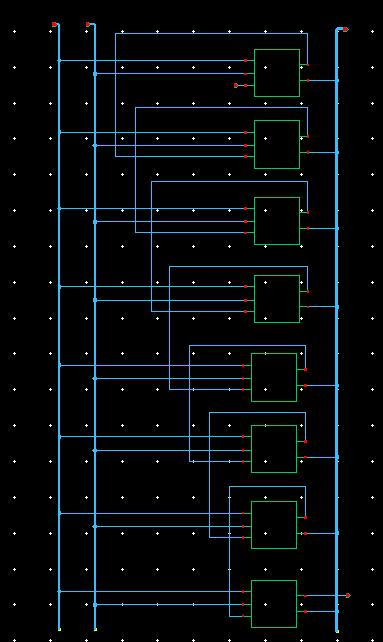

### 2. Symbol Generation
A custom symbol was created for the 8-bit adder, utilizing bus notation (`A<7:0>`, `B<7:0>`, `S<7:0>`) to keep the higher-level ALU schematic clean and modular.

*(8-bit RCA Symbol)*
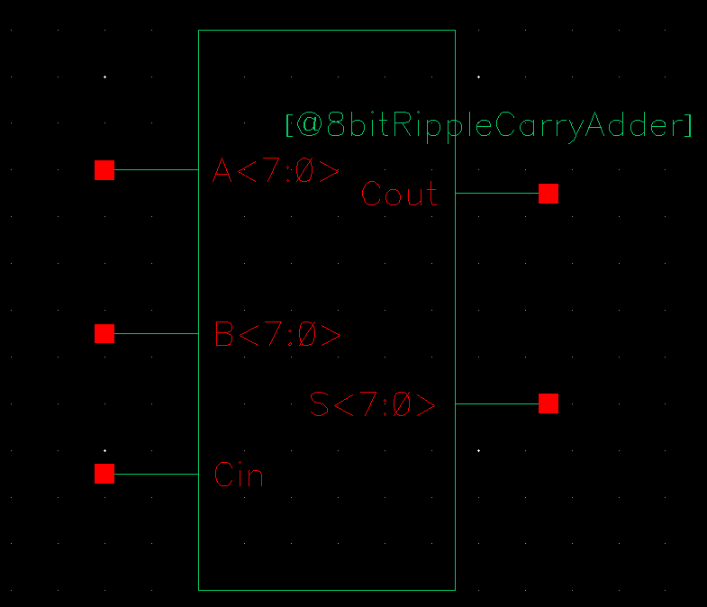

### 3. Pre-Layout Transient Simulation
Transient analysis was performed using **Cadence ADE L** to evaluate the arithmetic functionality and the worst-case carry propagation delay.

*(Pre-Layout Simulation Waveform)*
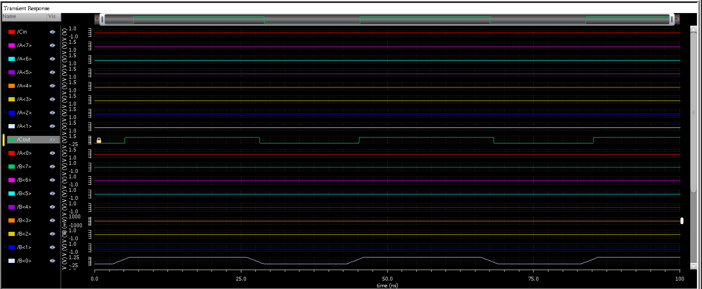

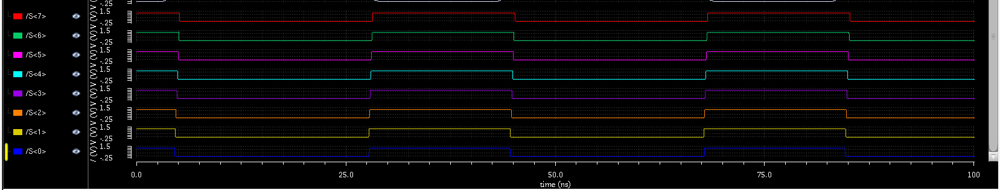

#### Pre-Layout Performance Metrics
The Virtuoso Calculator was used to measure the delay and average power. The critical path was analyzed by triggering a carry that ripples through all 8 stages.

* **Average Power Consumption:** **19.76 µW (19.76E-6 W)**
* *Methodology:* Calculated using the `average(getData(":pwr" ?result "tran"))` function over the simulation window.
* 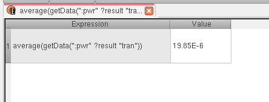
* **Worst-case Propagation Delay:** **678.6 ps**
* 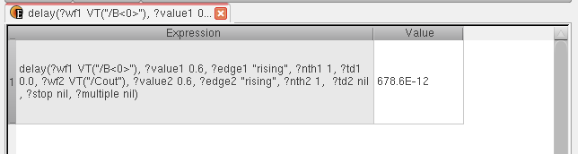

---

## Post-Layout Verification & Analysis

### 1. Custom Layout
The layout was generated hierarchically by assembling the layouts of the individual 1-bit Full Adders. A long, extremely dense physical block was created, requiring careful alignment of the internal carry routing to minimize delay.

*(8-bit RCA Layout Details)*
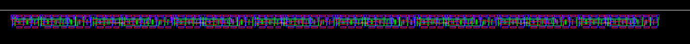
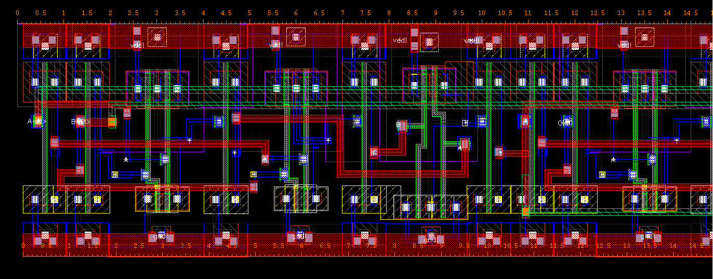
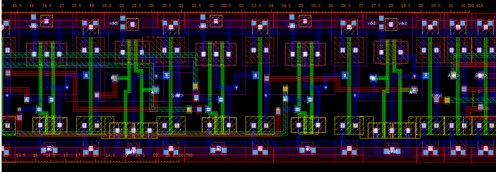
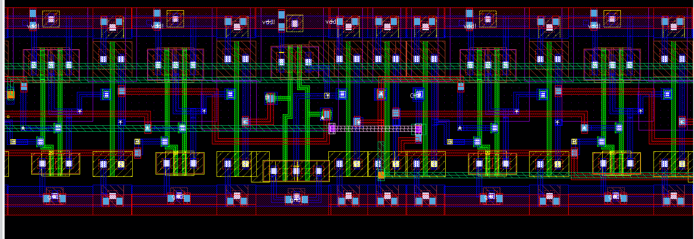
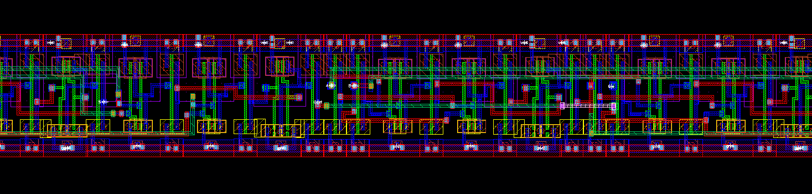
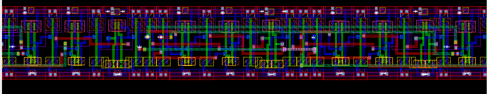
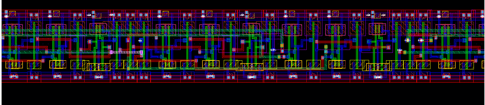
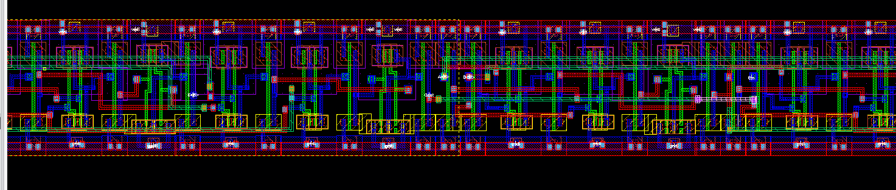

### 2. DRC & LVS Check
* **Design Rule Check (DRC):** Passed (0 Errors).
* **Layout Versus Schematic (LVS):** Passed. The extracted netlist exactly matches the hierarchical 8-bit schematic.

### 3. Post-Layout Transient Simulation (av_extracted)
The `av_extracted` view was generated using Assura Quantus QRC to include parasitic resistances and capacitances contributed by the cascaded interconnects, which are significant in a ripple carry architecture.

*(av_extracted View)*
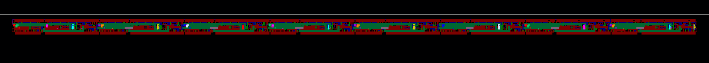

*(Post-Layout Simulation Waveform)*
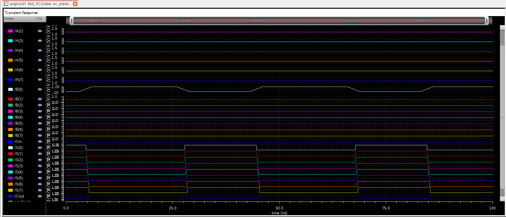

#### Post-Layout Performance Metrics
* **Average Power Consumption:** **22.57 µW (22.57E-6 W)**
* 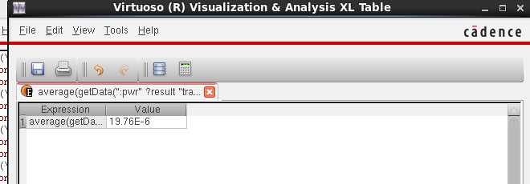
* **Worst-case Propagation Delay:** **5.411 ns**
* 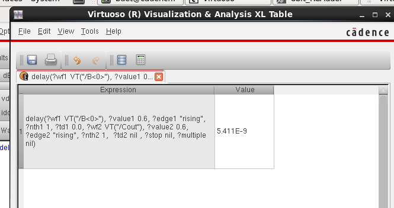

---

## Pre-Layout vs. Post-Layout Comparison

| Metric                        | Pre-Layout (Schematic) | Post-Layout (Extracted) | Deviation   |
| :---------------------------- | :--------------------- | :---------------------- | :---------- |
| **Average Power**             | 19.76 µW               | 22.57 µW                | **+14.22%** |
| **Worst-case Propagation Delay** | 678.6 ps            | 5.411 ns                | **+697.4%** |

*Analysis:*
Average power increased only moderately (+14.22 %), indicating that dynamic switching power still dominates and the additional parasitic capacitance from the dense interconnects has a limited impact on total energy for the applied test vectors.  

In contrast, the worst-case carry-propagation delay rose dramatically (+697.4 %). This is expected in a pure ripple-carry architecture: each successive stage adds both gate delay and the RC delay of the carry wire. The long, narrow layout further exacerbates the cumulative interconnect resistance and capacitance, turning the critical path into a severe bottleneck.
