# 8-Bit Arithmetic Logic Unit (ALU) - Custom IC Design

## Overview
This directory contains the custom transistor-level design, simulation, and verification of the 8-bit Arithmetic Logic Unit (ALU). This is the core computational module of the SAP-1 processor project. The design is implemented hierarchically using **Cadence Virtuoso** and the **gpdk090 (90nm) CMOS process technology**.

## Design Highlights
*   **Technology Node:** Cadence gpdk090 (90nm)
*   **Scale:** Integrates approximately **360+ transistors**.
*   **Architecture:** 
    *   8-bit Ripple Carry Adder (cascaded 1-bit Full Adders).
    *   Subtraction Logic via an XOR bank for 2's complement generation.
    *   Tristate Buffer output control for safe W-bus interfacing.
*   **Verification:** Passed **DRC** and **LVS** checks.

---

## Pre-Layout Design & Simulation

### 1. Schematic Design
The ALU was constructed using a hierarchical design methodology. Pre-designed custom blocks including the 1-bit Full Adder (`FA1X1`), 2-input XOR gates, and Tristate Buffers were instantiated to build the complete 8-bit datapath. The `sub_en` signal controls the XOR bank to invert the 'B' input and is also tied to the $C_{in}$ of the first adder to achieve 2's complement subtraction. The `buffer_en` signal controls the output transmission gates.

*(ALU_8bit Schematic)*
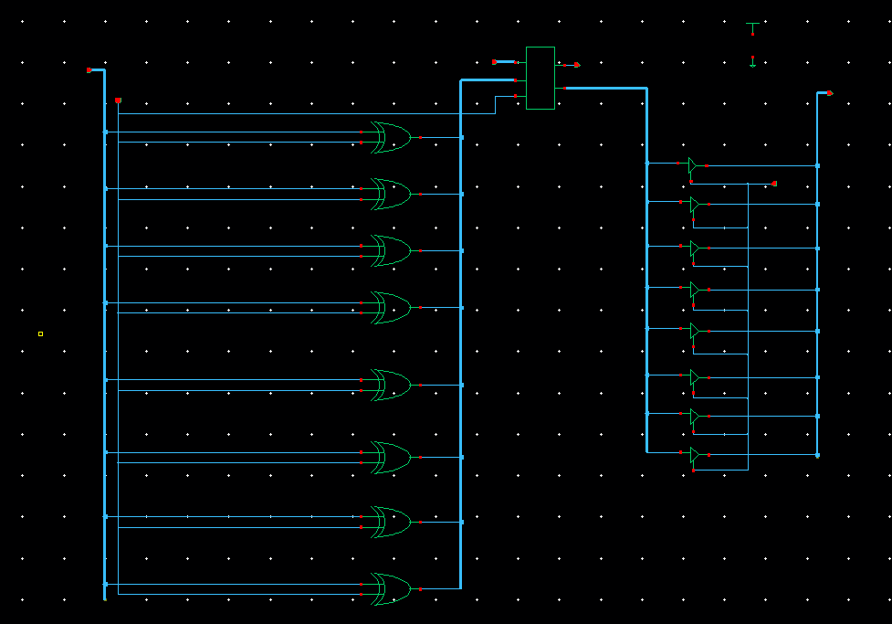

### 2. Symbol Generation
A custom symbol was created for the 8-bit ALU to allow for its integration into the top-level CPU schematic.

*(ALU_8bit Symbol)*
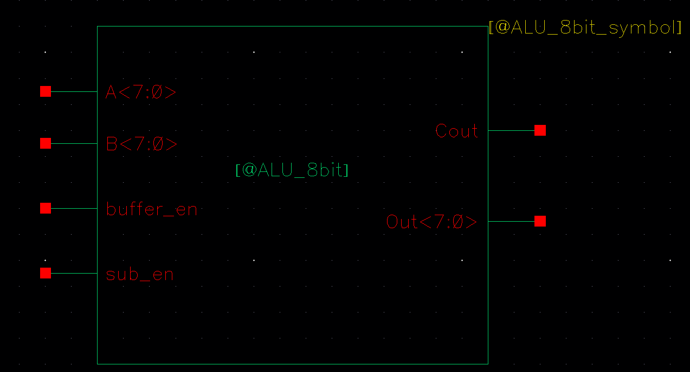

### 3. Pre-Layout Transient Simulation
Transient analysis was performed using **Cadence ADE L** to evaluate the functionality. The simulation verified both addition and subtraction operations, confirming the correct generation of sum/difference and carry-out flags.

*(Pre-Layout Simulation Waveforms)*
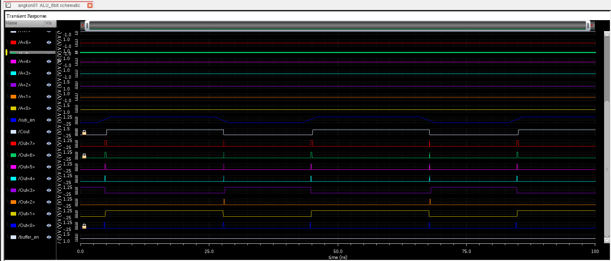
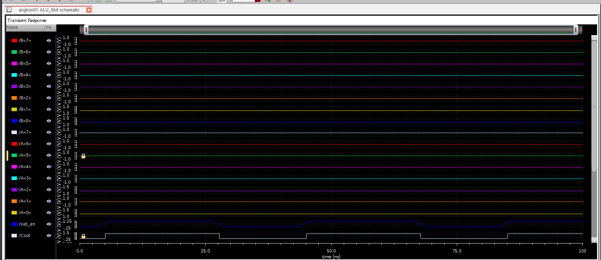

#### Pre-Layout Performance Metrics
The Virtuoso Calculator was used to extract the critical path delay (worst-case ripple scenario) and average power dissipation from the transient simulation data.

*   **Worst-case Propagation Delay:** **156.2 ps (156.2E-12 s)**
    *   *Methodology:* Measured by triggering a carry ripple from the LSB to the MSB and measuring the time difference between the input pulse at $B<0>$ and the final `Cout` rising edge (Threshold = 0.6V).
    *   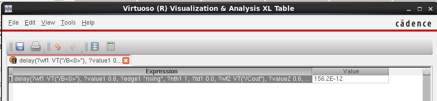
*   **Average Power Consumption:** **75.84 µW (75.84E-6 W)**
    *   *Methodology:* Calculated using the `average(getData(":pwr" ?result "tran"))` function over the simulation window, capturing dynamic power during math operations.
    *   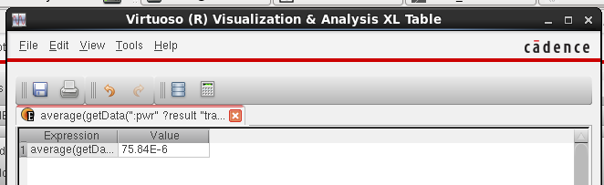

---

## Post-Layout Verification & Analysis

### 1. Custom Layout
The layout of the 8-bit ALU was generated hierarchically, integrating the layouts of the individual sub-blocks. 

*(ALU_8bit Layout)*
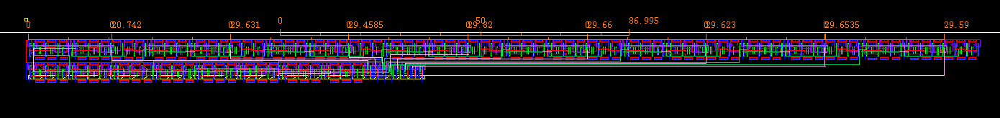
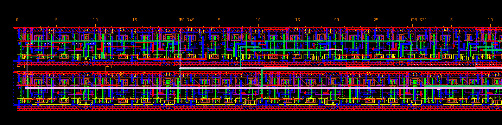
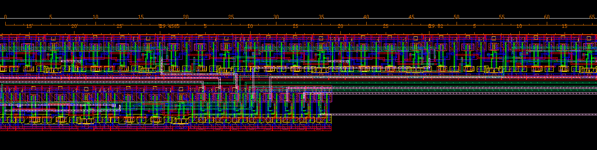
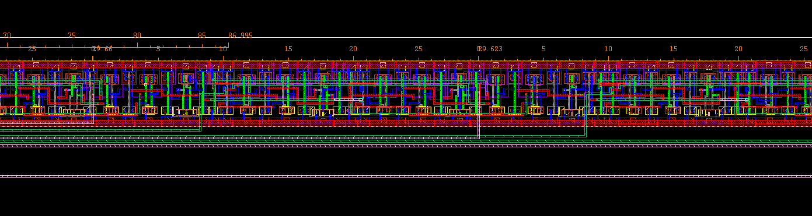
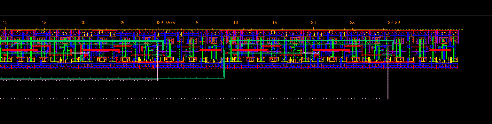

### 2. DRC & LVS Check
*   **Design Rule Check (DRC):** Passed (0 Errors). The layout adheres to all minimum spacing, width, and enclosure rules of the gpdk090 technology.
*   **Layout Versus Schematic (LVS):** Passed. The final layout netlist matches the hierarchical schematic perfectly.

### 3. Post-Layout Transient Simulation (av_extracted)
The `av_extracted` view was generated using Assura Quantus QRC to include parasitic resistances and capacitances contributed by the extensive physical routing.

*(av_extracted View)*
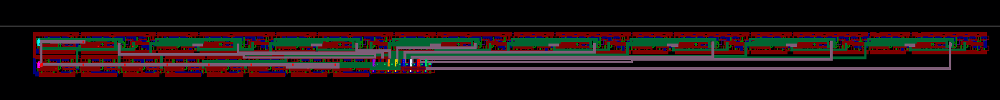
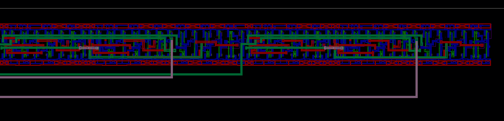
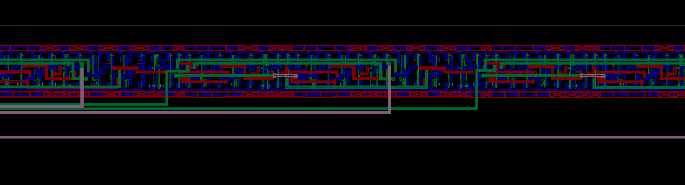
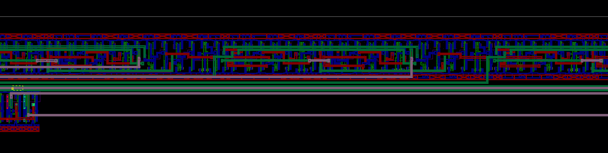
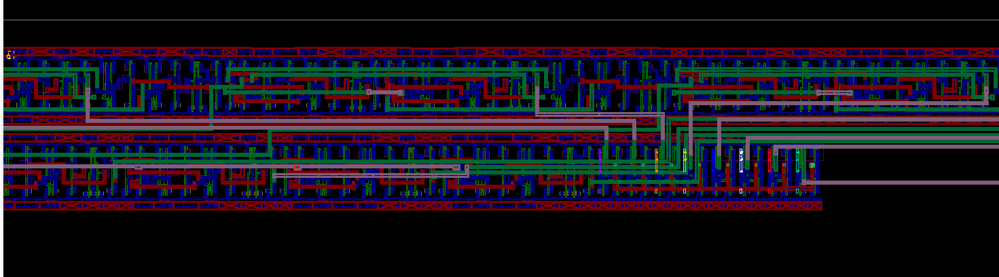
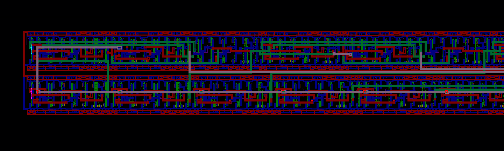

*(Post-Layout Simulation Waveform)*
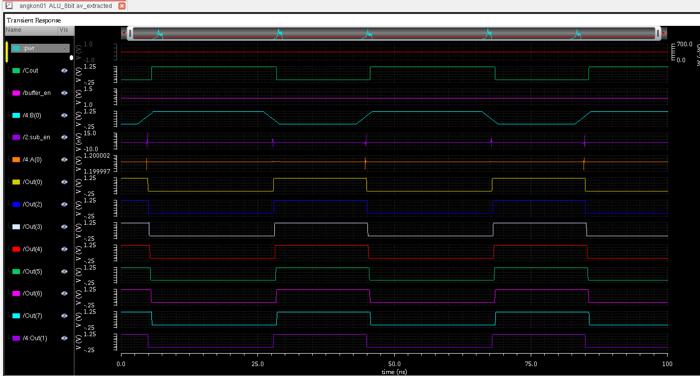

#### Post-Layout Performance Metrics
*   **Worst-case Propagation Delay (Critical Path):** **4.771 ns (4.771E-9 s)**
    *   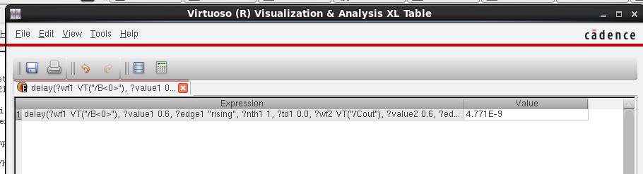
*   **Average Power Consumption:** **91.28 µW (91.28E-6 W)**
    *   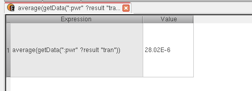

---

## Pre-Layout vs. Post-Layout Comparison

| Metric | Pre-Layout (Schematic) | Post-Layout (Extracted) | Deviation |
| :--- | :--- | :--- | :--- |
| **Propagation Delay (Critical Path)** | 156.2 ps | 4.771 ns | Massive Increase (~30x) |
| **Average Power** | 75.84 µW | 91.28 µW | ~20.36% increase |

*Analysis:* 
The massive increase in the critical path delay (from 156.2 ps to 4.771 ns) perfectly demonstrates the impact of parasitic RC elements in physical custom layout. In the schematic, wires are ideal. However, in the 360+ transistor layout, the extremely long internal routing buses (especially the carry-ripple chain cascading through 8 full adders) introduce significant interconnect capacitance and resistance. The increase in average power is also expected, as the circuit must now charge and discharge these real physical parasitic capacitances during switching operations. Based on the 4.771 ns critical path delay, the theoretical maximum operating frequency of this ALU is approximately **209 MHz**.
