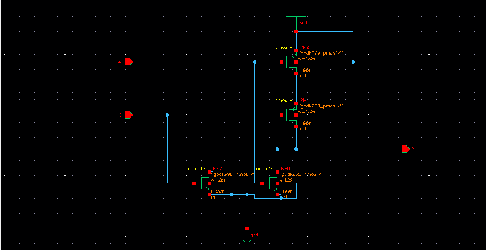
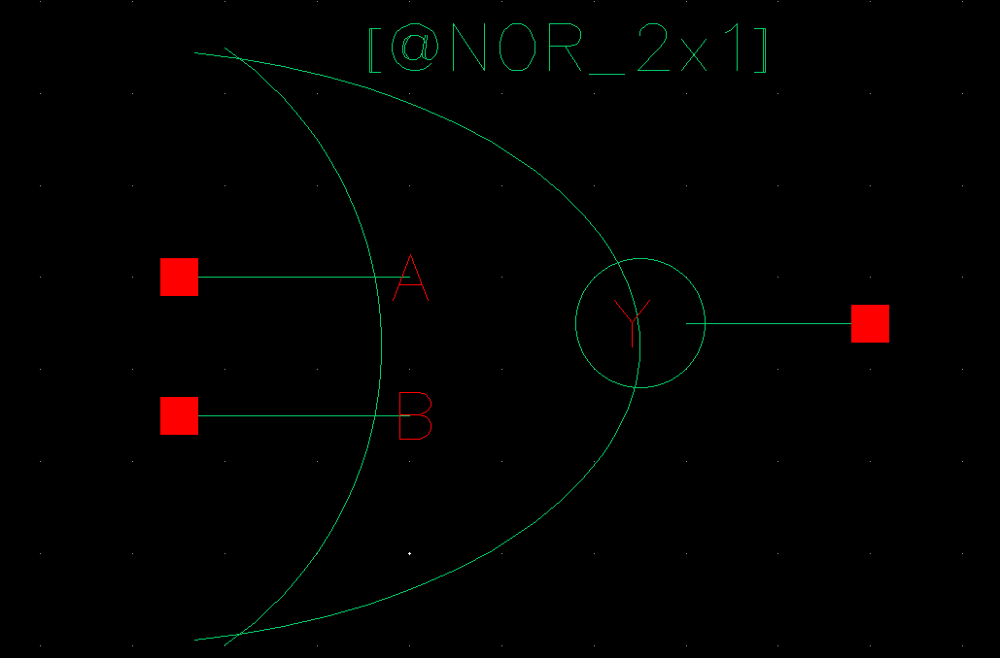
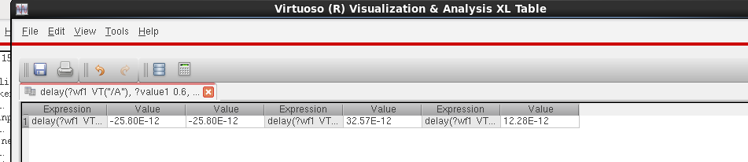
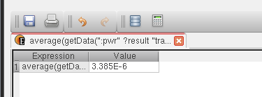

# 2-Input NOR Gate - Custom IC Design

## Overview
This directory contains the custom transistor-level design, simulation, and verification of a 2-Input CMOS NOR Gate. It is a fundamental building block for the 8-bit ALU project. The design is implemented using **Cadence Virtuoso** and the **gpdk090 (90nm) CMOS process technology**.

## Design Highlights
*   **Technology Node:** Cadence gpdk090 (90nm)
*   **Design Type:** Full-custom transistor-level design
*   **Transistor Sizing:** 
    *   **PMOS:** Width = 480nm, Length = 100nm
    *   **NMOS:** Width = 120nm, Length = 100nm
*   **Verification:** Passed **DRC** and **LVS** checks.

---

## Pre-Layout Design & Simulation

### 1. Schematic Design
The 2-Input NOR gate was designed at the transistor level using `nmos1v` and `pmos1v` devices from the gpdk090 library. To ensure balanced rise and fall times, the PMOS width was sized to be four times the NMOS width ($W_p = 4W_n$) due to the series connection of PMOS devices and parallel connection of NMOS devices in a standard CMOS NOR architecture.

*(NOR Schematic)*

### 2. Symbol Generation
A custom symbol was created for the NOR gate to allow for hierarchical design reuse in larger circuits.

*(NOR Symbol)*

### 3. Pre-Layout Transient Simulation
Transient analysis was performed using **Cadence ADE L** to evaluate the logical functionality and timing characteristics. Pulse voltage sources were applied to the inputs (A and B) with different periods to verify all logic combinations. The output correctly demonstrated NOR logic (output is high only when both inputs are low).

*(Pre-Layout Simulation Waveform)*

#### Pre-Layout Performance Metrics
The Virtuoso Calculator was used to measure the delay and power from the transient simulation data.

*   **Propagation Delay:** **32.57 ps (32.57E-12 s)**
    *   *Methodology:* Measured from the 50% point of the input transition to the 50% point of the output transition (Threshold = 0.6V).
    *   
*   **Average Power Consumption:** **3.385 µW (3.385E-6 W)**
    *   *Methodology:* Calculated using the `average(getData(":pwr" ?result "tran"))` function over the simulation window.
    *   

---

## Post-Layout Verification & Analysis

### 1. Custom Layout
The layout was manually routed using Metal 1 for interconnects, Poly for the gate, and appropriate N-well/P-sub contacts. The design was optimized to maintain a constant standard cell height for integration into the larger ALU datapath.

*(NOR Layout)*

### 2. DRC & LVS Check
*   **Design Rule Check (DRC):** Passed (0 Errors). The layout strictly adheres to the gpdk090 technology spacing and sizing rules.
*   **Layout Versus Schematic (LVS):** Passed. The extracted netlist perfectly matches the schematic.

### 3. Post-Layout Transient Simulation (av_extracted)
The `av_extracted` view was generated using Assura Quantus QRC to include parasitic resistances and capacitances contributed by the physical routing. 

*(av_extracted View)*

*(Post-Layout Simulation Waveform)*

#### Post-Layout Performance Metrics
*   **Propagation Delay:** **41.46 ps (41.46E-12 s)**
    *   
*   **Average Power Consumption:** **3.373 µW (3.373E-6 W)**
    *   

---

## Pre-Layout vs. Post-Layout Comparison

| Metric | Pre-Layout (Schematic) | Post-Layout (Extracted) | Deviation |
| :--- | :--- | :--- | :--- |
| **Propagation Delay** | 32.57 ps | 41.46 ps | ~27.29% increase |
| **Average Power** | 3.385 µW | 3.373 µW | ~0.35% decrease |

*Analysis:* 
As expected in physical custom design, the post-layout propagation delay increased noticeably (by ~27%) compared to the ideal schematic. This increase is primarily due to the introduction of parasitic RC elements (capacitance from the substrate, gate-to-drain overlap, and interconnect resistance) modeled in the `av_extracted` view. The average power consumption remained almost identical, indicating that the switching activity and short-circuit power are consistent between the schematic and the optimized physical layout.
